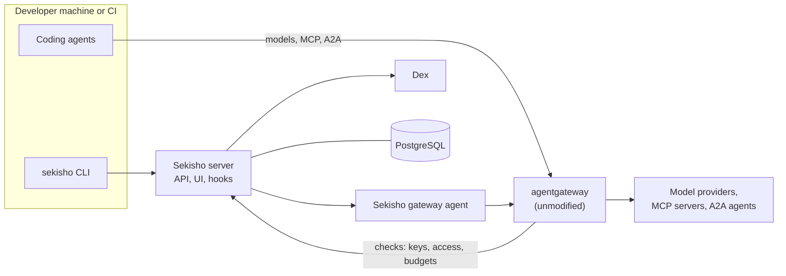

# Sekisho

Sekisho is an open-source control plane for coding agents such as Claude Code,
Codex, Gemini CLI and OpenCode. It decides which models, MCP servers, skills
and plugins each team's agents get, keeps the provider keys, caps spend in
dollars, and records what happened.

The name comes from the *sekisho* (関所), the checkpoints on Japan's Edo-period
highways, where guards checked each traveller's papers and decided who passed
and what they carried.

> **Status:** early design. Nothing is implemented yet.

## What release 1 will do

- **Environments.** Each team gets one bundle:
  - who may use it;
  - its models, MCP servers and A2A agents;
  - its skills, plugins and prompts;
  - its budgets.

  Environments are edited in the web UI, or kept in Git, where UI edits become
  pull requests.
- **Keys.** People sign in and use short-lived tokens. CI and automation use
  environment keys that can expire, and can be suspended, resumed or revoked.
  Revoking a key ends running sessions within seconds.
- **Dollar budgets** per person, per environment and per key, priced from the
  gateway's model catalog.
- **MCP and A2A.** One governed MCP endpoint per environment, with tool
  allow-lists and per-user sign-in to remote MCP servers. A2A agents go behind
  the same gateway.
- **Catalogs from Git.** MCP servers, skills, plugins and prompts, pinned to
  commits. The MCP and skill catalogs use Obot-compatible formats.
- **Delivery.** `sekisho use <environment>` installs an environment into Claude
  Code, Codex, Gemini CLI or OpenCode, with a lock file and content checks.
- **Sign-in** with local accounts, GitHub, GitLab, Google, Microsoft Entra, LDAP,
  SAML or any OIDC provider.
- **Audit** of model calls, MCP tool calls, access decisions and admin changes.
- **No licence keys, user caps or phone-home.**

## How it works

- **[agentgateway](https://github.com/agentgateway/agentgateway)** carries all
  traffic. Sekisho configures it, and answers its external authorisation,
  rate-limit and response-processing calls for every request.
- **The Sekisho server** (Rust) holds environments, keys, budgets and catalogs
  in PostgreSQL. It is the OAuth server for its CLI, UI and MCP clients.
- **[Dex](https://github.com/dexidp/dex)** connects local accounts and external
  identity providers.
- **The web UI** is React and TypeScript, served by the Sekisho server.

It will run with Docker Compose for trying it out, and on Kubernetes with Helm
for production.

## Licence

Apache-2.0. See [LICENSE](LICENSE).

## Background

Sekisho builds on ideas from several projects:

- [ackstorm/ach](https://github.com/ackstorm/ach) (Agent Capability Hub):
  governed environments, environment keys, dollar budgets and delivery to
  coding tools;
- [Obot](https://github.com/obot-platform/obot): the overall shape of the
  platform and its catalog formats;
- [Microsoft APM](https://github.com/microsoft/apm): lock files and content
  checks;
- the [Agentic Identity Broker](https://github.com/zalando-incubator/agentic-identity-broker):
  delegated access to SaaS MCP servers;
- [Cupcake](https://github.com/eqtylab/cupcake): rules on each tool call.
