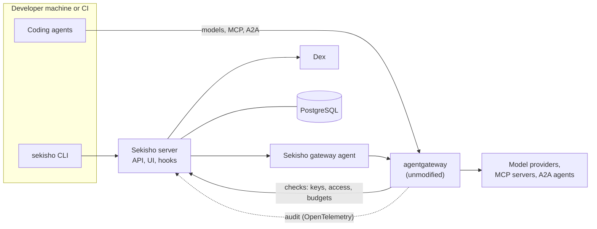

# Sekisho

Sekisho is an open-source control plane for coding agents such as Claude Code,
Codex, Gemini CLI and OpenCode. It decides which models, MCP servers, skills
and plugins each team's agents get, keeps the provider keys, caps spend, and
records what happened.

The name comes from the *sekisho* (関所), the checkpoints on Japan's Edo-period
highways, where guards checked each traveller's papers and decided who passed
and what they carried.

> **Status:** release 1 is being built, and isn't ready to use yet. Its first
> part, the model gateway, works and is tested end to end against agentgateway
> v1.7.0: an admin API for providers, models, environments, environment keys
> and dollar budgets; gateway configuration live in under a second; key and
> budget checks on every request, with spend recorded at the catalog price; and
> running streams cut about a second after a key is revoked. Sign-in, the web
> UI, the CLI, MCP servers and catalogs come next. Everything below describes
> what release 1 will do.

## What release 1 will do

- **Environments.** Each team gets one bundle:
  - who may use it, and an owner;
  - its models and its default model, MCP servers (each with a tool
    allow-list) and A2A agents;
  - its skills, plugins and prompts;
  - its budgets;
  - labels, such as a cost centre, which travel with its spend exports.

  Environments are edited in the web UI or through the API, exported and
  imported as YAML, or kept in Git, where UI edits become pull requests
  (GitHub first).
- **Models and providers.** Anthropic, OpenAI, Gemini, Amazon Bedrock, Azure
  and any OpenAI-compatible endpoint. Provider keys are encrypted at rest and
  never reach developers. A request for a model the environment doesn't allow
  is refused before it reaches a provider.
- **Keys.** People sign in and use short-lived tokens, which the CLI fetches
  when a coding tool needs one, so no long-lived secret is written to a
  developer's machine. CI and automation use environment keys (`sek_…`) that
  can expire, can carry their own budget, and can be suspended, resumed or
  revoked. Revoking a key ends running sessions within seconds.
- **Fail-closed.** Unknown, expired and revoked keys are always refused. If
  the gateway can't reach Sekisho's checks, requests are refused too, unless an
  admin chooses to let that check fail open.
- **Budgets** per person (in one environment or across all), per
  environment and per key, over a day, week or month, priced from the
  gateway's model catalog. When a budget runs out, the next request is refused
  with a message naming the budget and when it resets.
  - Budgets and spend are shown in your currency: an admin picks the
    display currency and sets its exchange rate. Underneath, Sekisho records
    spend in US dollars, the currency providers price in.
  - Budgets send alerts to signed webhooks, at 50%, 80% and 100% by default.
  - Spend exports as CSV, JSON or [FOCUS](https://focus.finops.org/), the
    FinOps cost format, so it can sit beside the rest of the company's cloud
    spend.
- **MCP and A2A.** One governed MCP endpoint per environment, combining its
  remote MCP servers, with tool allow-lists.
  - MCP clients such as Claude Code sign in to Sekisho themselves.
  - Sekisho signs each user in to remote servers that need OAuth (GitHub,
    Slack, Linear and so on), keeps their tokens, and sends each request with
    its own user's token.
  - It works with clients on the 2026-07-28 MCP specification and on earlier
    ones.
  - Local (stdio) MCP servers run on the developer's machine.
  - A2A agents go behind the same gateway, with the same checks.
- **Catalogs from Git.** MCP servers, A2A agents, skills, plugins and prompts,
  pinned to commits. The MCP and skill catalogs use Obot-compatible formats;
  plugins use Claude Code's plugin and marketplace format.
  - Every catalog entry has an owner.
  - An admin can quarantine an entry. It leaves every environment at once and
    its owner is alerted. `sekisho status` warns developers who still have it
    installed, and their next `sekisho use` removes it.
- **Delivery.** `sekisho use <environment>` installs an environment into Claude
  Code, Codex, Gemini CLI, OpenCode, GitHub Copilot CLI, Pi, Qwen Code or Kilo
  CLI, for one project or globally:
  - model and MCP endpoints, the environment's default model, local MCP
    servers, skills, plugins and prompts;
  - a lock file, with checks for hidden Unicode characters and for paths that
    escape the target folder;
  - a diff of what changed.

  `sekisho status` also lists MCP servers and plugin marketplaces that Sekisho
  didn't install. That report stays on the developer's machine.
- **Sign-in** with local accounts, GitHub, GitLab, Google, Microsoft Entra,
  LDAP and Active Directory, SAML or any OIDC provider. Several can be on at
  once. Offboarding a person ends their sessions, revokes their keys and hands
  what they own to a new owner, in one step.
- **Audit** of model calls, MCP tool calls, access decisions and admin changes,
  with filters and CSV or JSON export. Prompts and responses are not recorded.
- **No licence keys, user caps or phone-home.** Kubernetes is optional.

## Using it

A developer signs in once, installs their team's environment and starts their
coding tool:

```bash
sekisho login https://sekisho.example.com
sekisho use data-team
claude
```

| Command | What it does |
|---|---|
| `sekisho login [url]` | Sign in through a browser, or with `--no-browser` on a headless machine |
| `sekisho env list` | List the environments you can use |
| `sekisho use <env>` | Install an environment (`--target` picks the coding tool, `--global` installs for your user) |
| `sekisho status` | Show what's installed and whether it's current, your spend, and config Sekisho didn't install |
| `sekisho uninstall <env>` | Remove an environment |
| `sekisho token` | Print a fresh token; coding tools call it as a credential helper |
| `sekisho keys …` | Manage environment keys |
| `sekisho logout` | Sign out |

CI and containers set `SEKISHO_URL` and `SEKISHO_KEY` (an environment key)
instead of signing in. The CLI runs on macOS, Linux and Windows.

## How it works



- **[agentgateway](https://github.com/agentgateway/agentgateway)** carries all
  traffic. Sekisho configures it, and answers its external authorisation,
  rate-limit and response-processing calls for every request. Sekisho never
  forks or patches it.
- **The Sekisho server** (Rust) holds environments, keys, budgets and catalogs
  in PostgreSQL. It is the OAuth 2.1 server for its CLI, UI and MCP clients,
  and receives agentgateway's traces for the audit. It can run as several
  replicas.
- **The gateway agent** runs next to each agentgateway. It receives
  configuration from the Sekisho server and writes agentgateway's config file,
  which agentgateway reloads live without ending running streams.
- **[Dex](https://github.com/dexidp/dex)** connects local accounts and external
  identity providers. Sekisho manages it, so admins never edit Dex's files.
- **The web UI** is React and TypeScript, served by the Sekisho server.

Each environment gets its own routes on the gateway:

| Route | For |
|---|---|
| `/env/<name>/anthropic` | Anthropic Messages API, for Claude Code and others |
| `/env/<name>/openai` | OpenAI-compatible API, for Codex, OpenCode and others |
| `/env/<name>/gemini` | Gemini API, for Gemini CLI and others |
| `/env/<name>/mcp` | The environment's MCP servers, combined |
| `/env/<name>/a2a/<agent>` | Each A2A agent |

## Running it

- **To try it:** one Docker Compose file starts Sekisho, the gateway agent with
  agentgateway, Dex and PostgreSQL, with a local admin account.
- **In production:** a Helm chart runs Sekisho and Dex with two or more
  replicas each, the gateway agent with agentgateway, and an external
  PostgreSQL.
- **Releases** will publish a server image and CLI binaries for macOS, Linux
  and Windows, with checksums. Each release names the agentgateway version it
  was tested with.

## Coming from Obot

Release 1 aims to let an Obot admin move a real team in an afternoon.

- Paste your Obot catalog repository URLs and Sekisho adds them as sources.
  MCP server and skill catalogs work as they are. Obot virtual MCP servers can
  become one environment each, and any differences are listed.
- Teams on Obot's local accounts can keep local accounts; no identity provider
  is needed.
- Sekisho reads the catalogs you point it at. It doesn't ship Obot's public
  catalog.
- Not yet: importing Obot's profiles, budgets and access policies, and running
  MCP servers centrally. Both are planned for release 2.

## Later releases

Plans for after release 1, which can change:

| Release | Adds |
|---|---|
| 2 | Hosted MCP servers, with egress rules; importing Obot profiles, budgets and access policies; rate limits on requests and tokens; model routing and fallbacks; more coding tools; enforced settings for each coding tool, including sandbox and approval modes; an MCP Registry API endpoint, and the official MCP Registry as a catalog source; MCP's Enterprise-Managed Authorization (ID-JAG); Kubernetes pods and CI jobs signing in with their own identity tokens; SCIM; email invites and password resets; catalog entry lifecycle, access requests, scanners and signature checks; a webhook for risk signals from other security tools |
| 3 | Human approval of tool calls, including on a phone; guardrails; audit streamed to a SIEM; detecting changed MCP tool definitions; rules that depend on earlier actions in a session; adoption analytics, with usage per catalog entry; tamper-evident audit; a compliance mapping, with a dated inventory export |
| 4 | A device agent: an inventory of each machine's AI tools, and per-action rules |

## Licence

Apache-2.0. See [LICENSE](LICENSE).

## Background

Sekisho builds on ideas from several projects:

- [ackstorm/ach](https://github.com/ackstorm/ach) (Agent Capability Hub):
  governed environments, environment keys, dollar budgets and delivery to
  coding tools;
- [Obot](https://github.com/obot-platform/obot): the overall shape of the
  platform and its catalog formats;
- [Microsoft APM](https://github.com/microsoft/apm): lock files and content
  checks;
- the [Agentic Identity Broker](https://github.com/zalando-incubator/agentic-identity-broker):
  delegated access to SaaS MCP servers;
- [Cupcake](https://github.com/eqtylab/cupcake): rules on each tool call.
